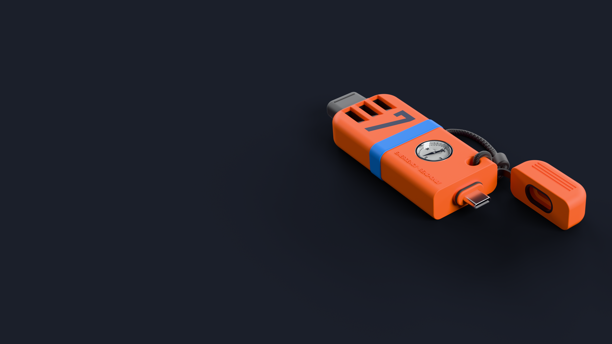
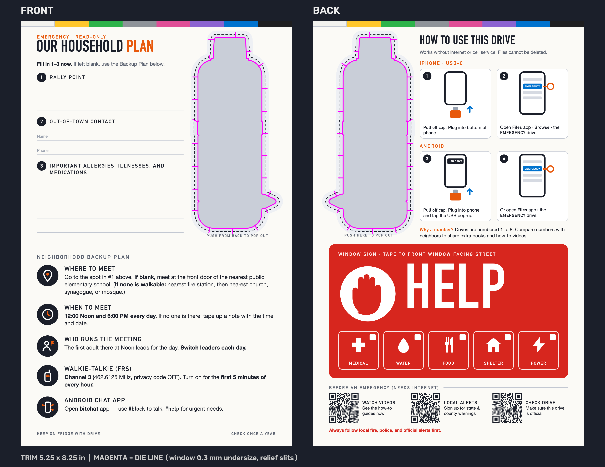
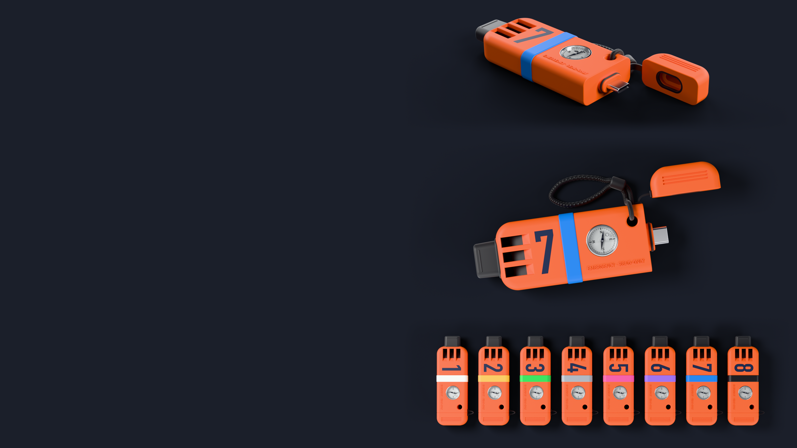

# Common Knowledge



Common Knowledge is a proposed read-only emergency USB drive for every U.S.
household. The USB-C drive has a whistle and compass built into its body and
is attached to a printed card. USB-A-only devices use an adapter. Every drive
carries the same core. Eight numbered versions add different reference material
and are distributed at random. The core is designed to open on a phone without
internet, an app store, or advance setup.



The universal card fits every version of the drive. These are design previews;
the kit and emergency instructions remain in development. [Print files and more views](#design-previews)
are below.

**This repository is the recipe, not the cargo.** Git holds code, original text,
configuration and a pinned source catalog. Build tools will fetch and verify maps,
archives, apps, fonts, models and imported media. Those files do not belong in git.

## Current state

The repository includes shared configuration, all fifteen document editions,
source verification, capacity planning, FAT32 assembly, and pipelines for the
atlas, public places, Android maps, reference archives, medical PDFs,
imported media, and library collections. Offline AI is deferred to v0.2 and
excluded from v0.1 content and placement. CI checks the development image, native
atlas renderer and browser interfaces. English is a draft; Spanish and the
thirteen quick starts are unreviewed machine translations.

Measured development work includes a matching pair of 158-article medical PDF
packs, a complete WikEM archive rebuilt from an offline source bundle, and a
strictly audited Simple English Wikipedia archive. Frozen WikEM, Wikibooks and
Wikivoyage pairs also match; see [archive checkpoints](docs/archive-freeze.md).
Forty byte-identical Ready.gov guides cover eleven selected editions under the
publisher's unchanged-copy terms; see [official guides](docs/official-guides.md).
The corrected national point
imports match across 254,873 places and 3,235 counties in 56 jurisdictions.
Earlier atlas/directory sets used a source snapshot missing Caribbean OSM places;
corrected descendant PDFs and final map repeats remain in progress. The five
territory map pairs match under the repaired converter recipe. See
[territory coverage](docs/territory-source-coverage.md),
[reference archives](docs/reference-collections.md), and
[source preservation](docs/source-bundles.md) for the evidence and its limits.

**v0.1.0 is incomplete and has not been released or approved for use.** Full
images remain blocked by unfinished catalog/library coverage, confirmed input
and asset rights, measured usable capacity, named human content review and
physical device tests. The sample/full commands now include input-generation orchestration; full-profile
execution and final image reproducibility still need validation. The version identifies development work. Unconfirmed
values remain explicit VERIFY markers, and releases fail while any remain.

The [verification site](https://trottier.github.io/common-knowledge/) is online
as a development catalog. No release files or full-image hashes are published
there. Its deployment does not approve the kit or its emergency instructions.

The complete specification and work order are in [AGENTS.md](AGENTS.md).
[CLAUDE.md](CLAUDE.md) carries the same instructions.
[docs/roadmap.md](docs/roadmap.md) tracks the remaining steps.

## Explore a development drive

The development Drive Explorer lets you browse an actual assembled folder at
phone widths, open PDFs and videos, read text, and inspect full filenames and
file sizes. From a local Python environment:

```sh
rtk proxy uv run ck explore --drive /path/to/assembled-drive
```

Open `http://127.0.0.1:8766/`. The explorer reads existing files without changing
them. Apps and other programs are download-only. A partial development tree
must carry an explicit notice, supplied with `--notice`; browsing it does not
establish physical-phone compatibility or a completed sample build.

The immediate milestone is Version 1 and Rhode Island, with a fast English
document and county-map preview before broader builds. PDF files have a shared,
provisional 10 MB guardrail. The goal of loading on 95% of phones still needs
device evidence. See [the explorer](pipelines/drive_preview/README.md).

## Design previews



| Design | Files |
| --- | --- |
| Universal card | [Front PDF](docs/design/card/universal/front.pdf), [back PDF](docs/design/card/universal/back.pdf), and [300 dpi artwork, print proof, and dieline](docs/design/card/universal/) |
| Drive-7 card | [Front PDF](docs/design/card/front.pdf), [back PDF](docs/design/card/back.pdf), and [300 dpi artwork, print proof, and dieline](docs/design/card/) |
| Drive views | [USB-C hero](docs/design/emergency_usb_7_hero_4k_v2.png) and [three-panel comparison with other versions](docs/design/emergency_usb_7_panels_4k.png) |
| Blueprint | [4K PNG](docs/design/emergency_usb_blueprint_4k.png) and [editable SVG](docs/design/emergency_usb_blueprint_4k.svg) |

Both card editions use the same window and identical `dieline.svg` files. The
universal edition has no card number; the Drive-7 edition carries its version
number. The PNG hero, panel layout, and blueprint are 3840 × 2160 pixels.

## Build and check

Install Docker with a running Linux container engine. From this directory:

```sh
make check
make cli
make package
make dev
```

`make check` builds `Dockerfile.build`, then runs Ruff, formatting checks and
pytest with networking disabled. `make cli` shows CLI help. `make package` writes
the source archive and wheel to the ignored `dist/` directory.

`make dev` writes the core PDFs and a verified, compressed development image to
`build/`. Run `make clean` before rebuilding those outputs. Development images
contain draft core documents; they do not contain third-party cargo or constitute
an approved emergency kit. See [docs/images.md](docs/images.md) for capacity,
manifest and reproducibility details.

After `make build-container`, inspect configuration and findability with:

```sh
docker run --rm --network=none --platform linux/amd64 common-knowledge-build:dev ck validate
docker run --rm --network=none --platform linux/amd64 common-knowledge-build:dev ck coverage --homes 5
```

The build platform is Linux x86-64. Docker on an ARM Mac needs x86-64 emulation.
Dependency installation requires internet access; the installed scaffold CLI does
not. See [docs/reproducibility.md](docs/reproducibility.md) for the exact pins,
sources and current limits.

For an editor's local Python environment, use Python 3.12 and `uv sync --locked`.
The container is the authoritative build and validation environment. Future
JavaScript tooling uses Bun where compatible with the specified rendering stack.

## Layout

| Path | Purpose |
| --- | --- |
| `config/` | Shared defaults, version assignments, languages, and build profiles (step 2) |
| `catalog/` | Pinned external sources and license proofs (step 5) |
| `content/` | Original Markdown and citations |
| `templates/`, `assets/icons/` | Document templates and original SVG pictograms |
| `pipelines/` | Atlas, directory, maps, reference, local LLM and media generation |
| `src/ck/` | Python CLI and build package |
| `tests/` | Automated checks |
| `docs/` | Project and build documentation |
| `.github/workflows/` | Development, sample, release and verification-site workflows |
| `site/` | Generated verification site; ignored by git |

## Contribute and license

Read [CONTRIBUTING.md](CONTRIBUTING.md), [CODE_OF_CONDUCT.md](CODE_OF_CONDUCT.md)
and [SECURITY.md](SECURITY.md) before contributing. Keep pull requests small and
use Conventional Commits.

Code, configuration, build tooling and repository documentation use Apache-2.0
([LICENSE](LICENSE)). Original drive text in `content/` and original pictograms
in `assets/icons/` use CC0-1.0 ([LICENSE-CONTENT](LICENSE-CONTENT)). Imported
material retains its own license and attribution; see [THIRD_PARTY.md](THIRD_PARTY.md).
